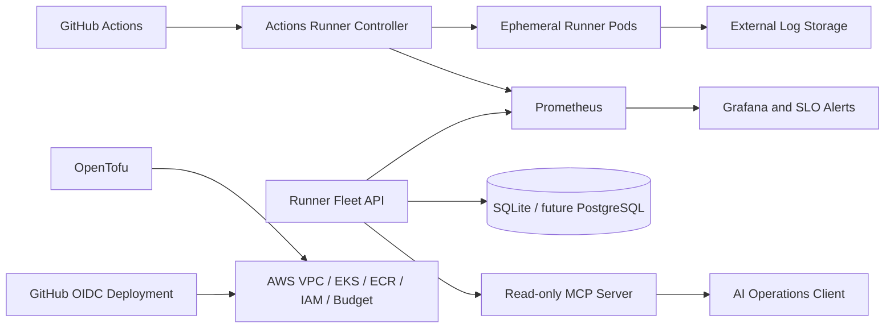

# Architecture

## Execution boundaries

- ARC owns the ephemeral runner lifecycle.
- OpenTofu owns AWS infrastructure state.
- Helm owns Kubernetes application releases.
- The FastAPI service stores evidence and calculates SLO, cost, and capacity
  recommendations.
- MCP exposes read-only evidence to AI clients.
- No MCP tool can apply infrastructure, scale a runner set, or execute a
  command.

The local lab runs one API replica because it uses SQLite. A production
deployment would move report history to PostgreSQL before enabling multiple
replicas.

## Environment progression

1. Deterministic local simulation.
2. Two kind clusters for primary and recovery experiments.
3. Temporary single-region EKS lab.
4. A second region only after the single-region system has measured evidence.
